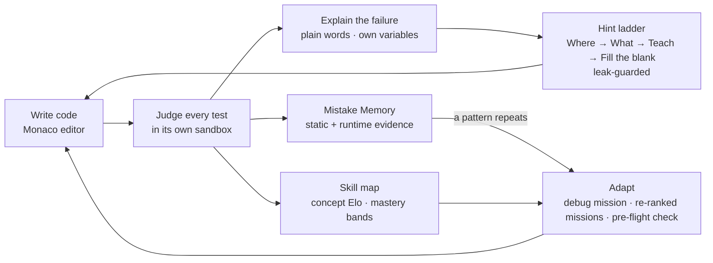
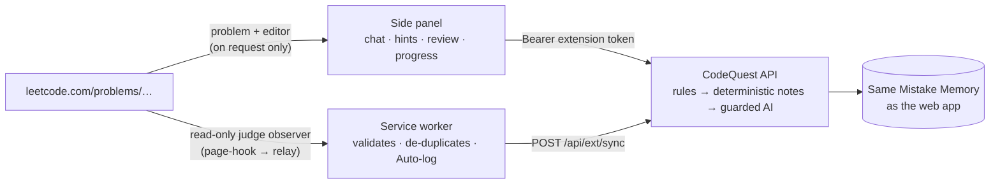
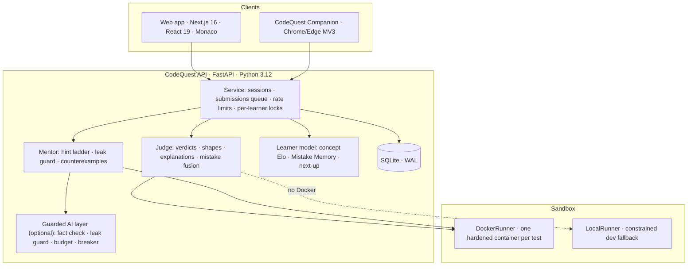

<div align="center">

# CodeQuest AI

### The coding mentor that explains every failure, remembers your mistakes, and never gives away the answer.

**Vortexa Hackathon 2026 · Domain 5: AI-Powered Education & Learning Technology · Problem Statement E-02**

[](https://www.python.org/)
[](https://fastapi.tiangolo.com/)
[](https://nextjs.org/)
[](docs/EXTENSION.md)
[](#testing-and-quality)
[](docs/SECURITY.md)
[](LICENSE)

[Quick start](#quick-start) · [LeetCode Companion](#the-leetcode-companion) · [How it meets E-02](#how-codequest-meets-problem-statement-e-02) · [Architecture](docs/ARCHITECTURE.md) · [Docs](#documentation)

</div>

<!-- TODO before submission: add the live demo URL and the demo video link here. -->

---

## At a glance

CodeQuest AI is a Python practice environment where **every failure teaches**. Learners solve tiered missions in a LeetCode-grade workspace; each test is judged separately inside a locked-down Docker sandbox; failures are explained in plain language with the learner's own variables; hints climb from *where to look* to *fill the blank* without ever revealing the solution; and a **Mistake Memory** notices the bugs a learner keeps making and rebuilds their next missions around them.

The same mentor follows the learner to **LeetCode** through the **CodeQuest Companion**, a browser side-panel tutor.

| 20 | 4 | 4 | 8 / 8 | 188 | 0 |
|:---:|:---:|:---:|:---:|:---:|:---:|
| missions across 5 tiers (15 build, 5 debug) | separate verdicts per test | hint levels, each more specific | hostile programs contained in the live Arena | backend tests passing | AI calls needed for any feature |

> **Deterministic first, AI second.** Diagnosis, explanations, hint content, mistake detection, adaptation and skill tracking are all deterministic and unit-tested. AI may only *reword* text that has already been verified, behind leak guards and a hard budget, and every learner can switch it off without losing a single feature.

---

## The problem

Beginners learn to program by writing code and reading what goes wrong, but the feedback they get rarely helps:

- **Tracebacks name an error without explaining it**, and code that runs can still return the wrong answer.
- **Pass/fail judges don't say where to look**, and hidden tests are a black box.
- **Full solutions arrive too early.** Copying from a chatbot gets code working but skips the debugging that builds skill.
- **No tool remembers.** Every submission is judged in isolation, so the same off-by-one comes back mission after mission.
- **Running unknown code is risky**: it must not read files, reach the network, or exhaust the machine.

## Our solution: a learning loop



---

## How CodeQuest meets Problem Statement E-02

Every requirement in the brief, how it is met, where it lives, and how it is verified.

| # | E-02 requirement | How CodeQuest meets it | Code | Verified by |
|---|---|---|---|---|
| R1 | Practice environment for **one language**, challenges at **increasing difficulty** | Python. 20 missions over tiers 1–5, from loops to binary search, sliding window, recursion and stacks; each tier maps to an Elo difficulty | `content/challenges/` | `test_tiers_and_debug_missions_cover_the_ladder` |
| R2 | Each challenge has a **description, starter code, visible tests and hidden tests** | Schema-validated YAML: ≥ 3 visible and ≥ 4 hidden tests per mission, references that must pass every test, starters that must not | `content.py` | `test_missions_load`, `test_references_pass_all_tests`, `test_starter_code_does_not_already_pass` |
| R3 | Execute submissions **only in a restricted environment** | One fresh Docker container per test: `--network none`, read-only root, non-root, all capabilities dropped, 256 MB memory, 32 PIDs, CPU and file limits. A constrained local runner is the labelled dev fallback | `sandbox/runner.py`, `sandbox/harness.py`, `runner/Dockerfile` | `test_sandbox.py` (19 tests), live **Sandbox Arena: 8/8 attacks contained** |
| R4 | Report **each test separately**: passed, wrong output, runtime error, timeout | Each test runs in its own process and gets exactly one of the four verdicts, with subtypes (blocked, memory limit, syntax, output limit) | `judge.py` | `test_judge.py` |
| R5 | **Never reveal hidden tests** | Hidden outcomes carry only index, verdict and a coarse category. Inputs, outputs, messages and locals are never captured or are erased before storage. Counterexamples exclude every test input | `judge.TestOutcome.public`, `probe.py` | `test_public_view_has_no_secrets`, `test_judge.py` |
| R6 | **Explain failures in plain language** | Deterministic templates: what happened → where → evidence (the learner's variables at the crash) → a guiding question. Wrong answers are classified by *shape* ("missing the last element", "printed instead of returned") | `analysis/explain.py`, `analysis/shape.py` | `test_judge.py`, `test_mentor.py` |
| R7 | **Progressive hints**, each more specific, **none revealing the solution, including AI hints** | Four-level ladder (Where → What with a generated counterexample → Teach on a different example → the learner's own line with one blank). Unlocks need a changed resubmission or a 45 s cooldown. A **leak guard** checks the union of all hints against every reference solution; AI may reword only hint 1 and must pass the same guard | `hints.py`, `ai.py` | `test_mentor.py` (25), `test_ai.py` (17) |
| R8 | **Detect recurring mistakes** (off-by-one, empty input, …) | 8 AST detectors plus syntax classes. A mistake is recorded only when static and runtime evidence agree. Decaying memory: recurring when strength ≥ 1.5 and seen in 2 of the last 5 attempts | `analysis/detectors.py`, `judge.fuse_mistakes`, `learner.py` | `test_judge.py`, `test_mentor.py` |
| R9 | **Adapt future challenges** to those mistakes | A matching debug mission is assigned, next missions are re-ranked toward the trap, and a pre-flight check is added before the next submit | `service._adaptation`, `learner.next_up` | `test_api.py`, `test_mentor.py` |
| R10 | **Track demonstrated skills by concept** | Elo per concept (primary 0.7 / secondary 0.3), credited by hints used; mastery requires predicted success ≥ 70 % **and** 2 verified solves | `learner.py` | `test_mentor.py` |

Details: [Mentor Engine](docs/MENTOR_ENGINE.md) · [Security Model](docs/SECURITY.md).

---

## Beyond the brief

| Feature | Why it matters |
|---|---|
| **[LeetCode Companion](#the-leetcode-companion)** | The same honest mentor inside LeetCode: problem-aware tutor chat, 3-level hints, approach checks, code review, auto-detected submissions that feed the same Mistake Memory |
| **Counterexample finder** | Hint 2 shows the *smallest* input where the learner's code goes wrong, found by exhaustive enumeration in the sandbox, never a hidden test |
| **Debug missions** | 5 hand-written broken programs with line budgets that train the skill the brief cares about most: reading and fixing code |
| **Sandbox Arena** (`/arena`) | A live red-team demo: file theft, network calls, cloud-metadata access, shell, fork bomb, memory bomb, infinite loop and output flood, all contained in front of the judges |
| **Guarded AI with a kill switch** | Optional rewording with a fact check, leak guard, persisted budget, circuit breaker and provider fallback. Settings shows provider, budget left, hints reworded and **leaks blocked** |
| **Personal roadmap** (`/roadmap`) | A 2-minute onboarding (goal, deadline, hours a week, level; no personal data) builds a week-by-week plan over a 25-topic prerequisite graph, mixing CodeQuest missions with 184 hand-picked LeetCode problems (link-out only) at the right difficulty. Recurring mistakes put drills first, and the plan flags when it should be re-planned. OpenAI writes the coach notes from the plan's facts only, behind a guard (no code, no links, no invented numbers) |
| **Syntax Warm-up** (`/typing`) | An animated, accuracy-first code-typing trainer: real Python picked for your weak concepts and recurring syntax slips, drills built from your own passing code, a personal pace caret, and speed computed on the server so results can't be faked |
| **Unified portfolio** (`/u/<handle>`) | A shareable profile that leads with skills **verified** by hidden tests, then imports public Codeforces and LeetCode stats mapped onto the same concepts |
| **Seeded demo learner** | "Priya" is built through the real learner-model functions, so her next off-by-one turns recurring live on stage |
| **Works offline** | Monaco is self-hosted, templates cover every feature, and the sandbox runs locally: the demo survives bad venue Wi-Fi |

---

## The LeetCode Companion

<table>
<tr>
<td width="55%" valign="top">

**A tutor in your browser's side panel that knows which LeetCode problem you are on, reads your code when you allow it, and never writes the solution.**

- **Problem-aware chat**: title, difficulty, tags and statement are loaded automatically. Ask anything.
- **Hint 1/3 → 3/3**: what to notice, then the sharper question, then the key observation. Never code.
- **Check my approach**: describe your plan; get *on track / partly / may not fit* plus one guiding question.
- **Review my code**: CodeQuest's mistake detectors on your Python, with the line and a question.
- **Explain · Edge cases · Complexity** on demand.
- **Auto-detected submissions**: press Submit on LeetCode and the verdict appears in the chat. With **Auto-log** on, mistakes flow into the same Mistake Memory as the web app.
- **Honest by construction**: requests for the answer are refused by rules before any model call; every AI reply passes a no-code output guard; every reply is labelled **AI tutor** or **CodeQuest**.
- **Respectful**: disabled during contests; problem text and code are never stored.

</td>
<td width="45%" valign="top">

**Install in four steps**

1. Get the code: `git clone` this repo, or **Code → Download ZIP** and unzip.
2. Open `chrome://extensions` (or `edge://extensions`) and switch on **Developer mode**.
3. Click **Load unpacked** and pick the [`extension/`](extension/) folder.
4. In CodeQuest, open **Settings → LeetCode Companion**, click **Generate pairing code**, then type the 6-character code into the panel.

Open any `leetcode.com/problems/...` page and click the CodeQuest icon.

📘 **[Full Companion guide](docs/EXTENSION.md)**: features, architecture, permissions, privacy, troubleshooting, testing and publishing.

</td>
</tr>
</table>



---

## Demo in four minutes

| Time | Moment | What the judges see |
|---|---|---|
| 0:00 | **Failure that teaches** | *Try the demo as Priya* opens Class Average. Her buggy loop gets four different verdicts on four visible tests. The crash card says: *"On line 11 (`return total / count`) your code divided by zero. At that moment: `scores` = [], `total` = 0, `count` = 0 …"* Hidden tests show only a category |
| 0:45 | **Hints without the answer** | Hint 1 points at lines; the cooldown blocks spamming; after one change, Hint 2 shows a minimal failing input. Every hint is leak-checked |
| 1:30 | **Mistake Memory** | Her second off-by-one in a different mission turns *recurring*: a debug mission is assigned, next missions are re-ranked, a pre-flight check appears |
| 2:15 | **Portfolio and Companion** | Verified skills plus imported Codeforces/LeetCode stats; then the Companion tutoring on a real LeetCode problem |
| 2:55 | **Sandbox Arena** | Eight live attacks, all contained, runner: `docker` |
| 3:35 | **AI off** | Priya switches AI off; hints and explanations are just as useful |

Full script with voice-over and fallbacks: [`docs/pitch/demo_script.md`](docs/pitch/demo_script.md).

---

## Architecture



A submission returns `202` immediately and is judged in a background pool; each test runs in its own sandbox (four in parallel); learner return values are serialised to primitive JSON and **compared on the host**, so learner code can't fake a pass. Full design, data model and failure handling: **[docs/ARCHITECTURE.md](docs/ARCHITECTURE.md)**.

### Tech stack

| Layer | Technology |
|---|---|
| Backend | Python 3.12, FastAPI, Pydantic v2, Uvicorn, SQLite (WAL) |
| Analysis | Python `ast`, `tokenize`, audit hooks; no third-party analysis dependencies |
| Sandbox | Docker (optional gVisor), hardened per-test containers |
| Frontend | Next.js 16 (App Router), React 19, TypeScript, Tailwind CSS 4, TanStack Query, Monaco Editor, Motion |
| Extension | Chrome Extensions Manifest V3: side panel, service worker, MAIN/ISOLATED content scripts |
| AI (optional) | OpenAI `gpt-4.1-nano` (hint wording), `gpt-4.1-mini` (Companion tutor), Gemini Flash-Lite fallback, all via standard-library HTTP |

---

## Quick start

**Prerequisites:** Python 3.12+, Node.js 20+, Docker (recommended; without it a constrained local runner is used and reported as *not sandboxed*), Chrome or Edge for the Companion.

```bash
git clone https://github.com/HarshalAndhale9657/CodeQuest-AI-AI-Coding-Mentor-Debugging-Missions.git
cd CodeQuest-AI-AI-Coding-Mentor-Debugging-Missions
cp .env.example .env                     # optional: add OPENAI_API_KEY for AI wording
```

**1. Build the sandbox image**

```bash
docker build -f runner/Dockerfile -t codequest-judge:latest .
```

**2. Start the API** (http://localhost:8000, OpenAPI docs at `/docs`)

```bash
cd backend
python -m pip install -e ".[dev]"
python -m uvicorn codequest.api:app --reload --port 8000
```

**3. Start the web app** (http://localhost:3000)

```bash
cd frontend
npm install
npm run dev
```

**4. Load the Companion**: see [the four steps above](#the-leetcode-companion).

Open http://localhost:3000 and click **Try the demo as Priya**, or start as a guest. Confirm the sandbox with `curl http://localhost:8000/api/health` → `"runner": "docker", "sandboxed": true`.

Configuration reference and production deployment: **[docs/DEPLOYMENT.md](docs/DEPLOYMENT.md)**.

---

## Testing and quality

```bash
cd backend && python -m pytest -q             # 188 tests
cd frontend && npm run typecheck && npm run lint
```

| Suite | Tests | Covers |
|---|---:|---|
| `test_content.py` | 63 | Every mission validates; references pass all tests; starters fail; counterexamples never flag a reference and always expose debug starters; public view has no secrets |
| `test_mentor.py` | 25 | Counterexamples (minimal, exclude every test input, survive infinite loops); ladder monotonicity; H4 blanks the learner's own line; unlock gate; leak guard incl. Unicode tricks; authored lessons vs. every mission; Mistake Memory recurring/beaten; Elo; adaptive next-up |
| `test_companion_chat.py` | 21 | Answer-seeking refused without a model call; deterministic modes; grounding; one strict retry on code; rules fallback on failure; budget and preference gating; endpoint auth and rate limit |
| `test_sandbox.py` | 19 | Parametrised attacks (files, network, processes, memory, loops, output) contained; verdict forgery and fake result markers rejected; hard exits |
| `test_ai.py` | 17 | Off without providers; caching; model sees only the note; shape, inline-code and fact checks; leak guard end to end; provider fall-through; circuit breaker; budget cap, reservation and persistence; only H1 is AI-worded, per learner |
| `test_portfolio.py` | 14 | Public portfolio; Codeforces import and cache; failures recorded, last good snapshot kept; handle validation; typing results; mistakes timeline; tag mapping |
| `test_extension.py` | 13 | Detectors inside class methods; pairwise loops not flagged; syntax errors; approach check; progressive concept hints; pairing and extension endpoints; sync feeds Mistake Memory |
| `test_judge.py` | 9 | All four verdicts from one submission; mistake fusion; specific visible explanations; hidden tests never leak; syntax errors; print vs return; bad initial value; base case; missing function |
| `test_api.py` | 7 | Auth required; challenge view hides secrets; the full Priya demo flow over HTTP; rate limit; Arena accepts an index only; consistent seed; judge retry after a sandbox blip |

The extension has its own dev harnesses in [`extension-tests/`](extension-tests/): a fake LeetCode judge server, a 17-check pipeline test and a stubbed side-panel UI ([details](docs/EXTENSION.md#12-testing-the-extension)).

---

## Security in one table

| Threat | Control |
|---|---|
| Reading host files or secrets | Read-only root FS, no mounts, user `65534`, code on stdin; tripwire blocks `open` |
| Network and cloud-metadata access | `--network none`; tripwire blocks sockets |
| Fork bombs, memory bombs, infinite loops, output floods | `--pids-limit 32`, `--memory 256m` (no swap), watchdog + host deadline, capped writers |
| Faking a pass | Values serialised in the sandbox, compared on the host; only the last marked record is trusted |
| Leaking hidden tests | Coarse category only; data never serialised; counterexamples exclude test inputs |
| Leaking the solution | Union leak guard over every hint; AI sees only the note; chat refusals and no-code output guard |
| Abuse and cost | Rate limits, 64 KiB code cap, persisted AI budget, per-learner AI switch |

Threat model, verified Arena results and known limitations: **[docs/SECURITY.md](docs/SECURITY.md)**.

---

## Repository layout

```
.
├── backend/                 FastAPI service (Python 3.12)
│   ├── codequest/
│   │   ├── api.py           HTTP routes and validation
│   │   ├── service.py       Use cases: submissions, hints, learner model, Companion
│   │   ├── judge.py         Per-test verdicts, explanations, mistake fusion
│   │   ├── hints.py         Hint ladder, unlock gate, leak guard
│   │   ├── learner.py       Concept Elo, Mistake Memory, next-up ranking
│   │   ├── ai.py            Optional guarded AI wording layer
│   │   ├── companion_chat.py  LeetCode tutor: rules, deterministic notes, guarded model
│   │   ├── extension.py     Tag→concept map, approach check, concept hints
│   │   ├── portfolio.py     Public profile, Codeforces/LeetCode import
│   │   ├── arena.py         Fixed red-team attacks
│   │   ├── analysis/        detectors · shape · explain · probe (counterexamples)
│   │   └── sandbox/         harness (runs inside) · runner (Docker / local)
│   └── tests/               188 tests
├── content/challenges/      20 missions (YAML)
├── frontend/                Next.js web app (quest map, workspace, portfolio, arena, settings)
├── extension/               CodeQuest Companion (Chrome/Edge MV3)
├── extension-tests/         Dev harnesses for the extension
├── runner/Dockerfile        Sandbox image
└── docs/                    Architecture, mentor engine, security, API, extension, content, deployment
```

---

## Documentation

| Document | What's inside |
|---|---|
| [ARCHITECTURE.md](docs/ARCHITECTURE.md) | Components, submission lifecycle, verdict mapping, disclosure policy, data model, resilience |
| [MENTOR_ENGINE.md](docs/MENTOR_ENGINE.md) | Explanations, detectors, mistake fusion, hint ladder, leak guard, Mistake Memory, Elo, adaptation |
| [EXTENSION.md](docs/EXTENSION.md) | The LeetCode Companion: install, pairing, usage, internals, permissions, privacy, troubleshooting, publishing |
| [SECURITY.md](docs/SECURITY.md) | Threat model, sandbox layers, Arena results, hidden-test secrecy, known limitations |
| [API.md](docs/API.md) | Every endpoint with request and response shapes |
| [CONTENT_GUIDE.md](docs/CONTENT_GUIDE.md) | Mission catalogue, YAML schema, authoring rules, validation |
| [DEPLOYMENT.md](docs/DEPLOYMENT.md) | Environment variables, local setup, production, pre-demo checklist |
| [CONTRIBUTING.md](CONTRIBUTING.md) | Development workflow and conventions |

---

## Roadmap

| Next | Status |
|---|---|
| Companion on the Chrome Web Store, with the production server built in | Planned |
| Real accounts (sign-in, token rotation) and Postgres for multi-node deployments | Planned |
| More languages through the same judge contract (JavaScript next) | Exploring |
| In-browser execution (Pyodide) for instant visible-test runs | Exploring |

---

## Team

Built in a 3-person sprint for Vortexa Hackathon 2026.

| Role | Ownership |
|---|---|
| **Tech lead** | Sandbox and Docker runner, judge, API, learner model, AI layer, LeetCode Companion |
| **Frontend and UX** | Next.js app, Monaco workspace, results board, quest map, portfolio, LeetCode-style design system |
| **Content and pitch** | 20 missions, debug missions, typing corpus, demo script and pitch |

## License

[MIT](LICENSE)
