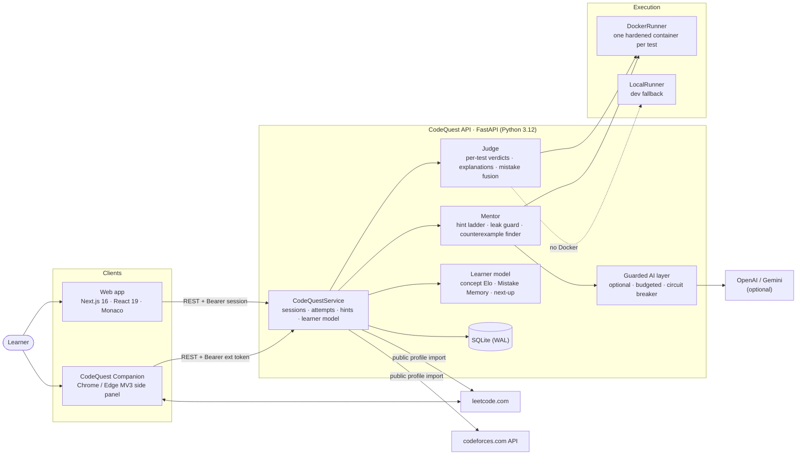
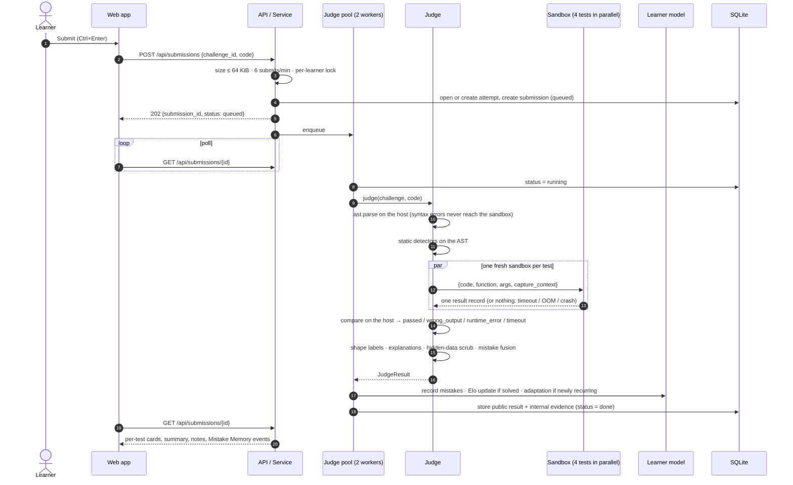
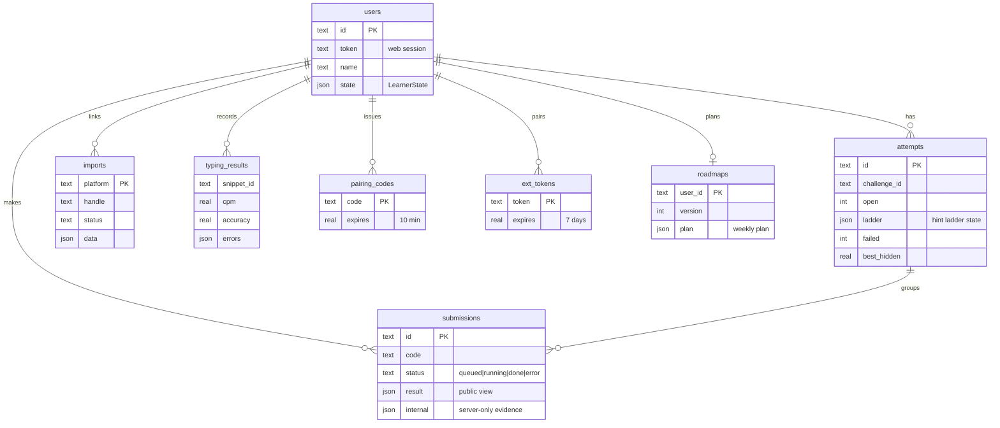

# Architecture

> How CodeQuest AI is put together, how a submission travels through it, and why it keeps working when parts of it fail.

**Design principle: deterministic first, AI second.** Every decision a learner sees (verdicts, explanations, hint content, mistake detection, adaptation, skill tracking) is computed by deterministic code that is unit-tested. An optional language model may only *reword* text that has already been verified, behind guards, with a hard budget. Turning AI off removes no capability.

---

## 1. System context

| Component | Code | Responsibility |
|---|---|---|
| HTTP API | `backend/codequest/api.py` | Routes, request validation (Pydantic), CORS, auth dependencies, error mapping |
| Service | `backend/codequest/service.py` | Use cases independent of HTTP: sessions, submissions queue, hints, AI preference, Companion, portfolio |
| Content | `backend/codequest/content.py`, `content/challenges/*.yaml` | Challenge schema, validation at load, public (disclosure-safe) view |
| Judge | `backend/codequest/judge.py` | Runs each test, maps raw runs to the four verdicts, explains, fuses mistakes, builds the public result |
| Sandbox | `backend/codequest/sandbox/` | `harness.py` runs inside the sandbox; `runner.py` launches it (Docker or local) |
| Analysis | `backend/codequest/analysis/` | Static detectors (AST), wrong-answer shape classifier, plain-language explainer, counterexample probe |
| Mentor | `backend/codequest/hints.py` | Four-level hint ladder, unlock gate, leak guard |
| Learner model | `backend/codequest/learner.py` | Concept Elo, Mistake Memory, mastery bands, next-mission ranking |
| Learning signals | `predict.py`, `journey.py`, `insights.py`, `analysis/rules.py` | Predict Before You Run, pass review (fragile passes, mission rules), Debug Journey, portfolio growth analytics ([MENTOR_ENGINE.md §10](MENTOR_ENGINE.md#10-learning-signals)) |
| Comparison | `backend/codequest/compare.py` | Host-side decoding and comparison of learner values (never inside the sandbox) |
| AI layer | `backend/codequest/ai.py` | Optional rewording of hint 1; shape check, fact check, leak guard, budget, cache, circuit breaker |
| Companion | `backend/codequest/extension.py`, `companion_chat.py` | LeetCode tag→concept map, approach check, concept hints, guarded tutor chat |
| Portfolio | `backend/codequest/portfolio.py` | Public profile; Codeforces and LeetCode imports mapped to the same concepts |
| Roadmap | `backend/codequest/roadmap.py`, `content/roadmap/` | Deterministic week-by-week plan over a 25-topic prerequisite graph and a 184-problem LeetCode catalogue; optional guarded coach notes |
| Syntax Warm-up | `backend/codequest/typing_drills.py`, `content/typing/` | Typing drills ranked by weak concepts and syntax slips; speed and accuracy scored on the server |
| Demo seed | `backend/codequest/demo_seed.py`, `content/demo/priya.json` | Priya's judged history, copied into the store when a demo session starts; tests re-judge it so it can't drift |
| Arena | `backend/codequest/arena.py` | Fixed list of hostile programs run through the real runner, for a live security demo |
| Store | `backend/codequest/store.py` | SQLite in WAL mode, small JSON blobs per row |
| Web app | `frontend/src/` | Landing, quest map, mission workspace, onboarding, roadmap, typing trainer, portfolio, arena, settings |
| Extension | `extension/` | Side panel tutor on LeetCode (see [EXTENSION.md](EXTENSION.md)) |

---

## 2. The life of a submission

Key properties:

- **Asynchronous.** `POST /api/submissions` returns `202` immediately; the client polls. A slow sandbox never ties up an HTTP worker.
- **Comparison on the host.** The harness serialises the learner's return value to primitive, typed JSON (`__tuple__`, `__set__`, `__dict__`, `__float__`). The host decodes and compares it. Learner objects with a custom `__eq__` or `__repr__` can't fake a pass.
- **One process per test.** A crash, infinite loop or memory bomb in test 3 cannot affect the verdict of test 4.
- **Two views of every result.** The *public* result is what the learner sees and follows the disclosure policy. The *internal* evidence (findings with blank spans, fused mistakes, crash line, cached counterexample) stays on the server and feeds hints.

---

## 3. Verdict mapping

The harness reports what happened; the judge decides the verdict (`judge._verdict`).

| What the host observed | Verdict | Subtype |
|---|---|---|
| Value returned and equal to expected | `passed` | |
| Value returned but different | `wrong_output` | shape label, e.g. `missing_last`, `off_by_one_number`, `printed_not_returned` |
| Value can't be serialised (generator, custom object) | `wrong_output` | `unsupported_type` |
| Printed more than the output cap | `wrong_output` | `output_limit` |
| Exception in learner code | `runtime_error` | `exception` (with type, line, local variables on visible tests) |
| Blocked operation (file, network, process…) | `runtime_error` | `blocked` |
| `MemoryError` or container OOM-killed (exit 137) | `runtime_error` | `memory_limit` |
| Process died without a result | `runtime_error` | `sandbox_terminated` |
| Syntax error (caught on the host) | `runtime_error` for every test | `syntax` |
| In-sandbox watchdog fired, or host deadline passed | `timeout` | |

A *constant output* rule adds one more label: if at least three visible tests with different inputs and different expected outputs all got the same result, the learner is told the result doesn't change with the input.

---

## 4. Disclosure policy

Hidden tests must never leak. This is enforced in the data model, not just the UI.

| Field | Visible test | Hidden test |
|---|---|---|
| Index and verdict | ✅ | ✅ |
| Category | the test's tag | **coarse only** (`edge case`, `boundary`, `tricky values`, `large input`, `typical case`) |
| Input, expected, actual | ✅ | ❌ never serialised |
| Exception type, message, line | ✅ | ❌ message and locals are erased from the outcome right after explaining |
| Local variables at the crash | ✅ | ❌ not even captured (`capture_context: false`) |
| Printed output | ✅ (2,000 chars) | ❌ erased |
| Explanation | specific | built only from the verdict, the coarse category and static findings about the learner's **own** code |

The counterexample finder (hint 2) also excludes every test input, hidden or visible, before generating candidates, so a hint can never re-derive a hidden test.

---

## 5. Concurrency and state

| Concern | Mechanism |
|---|---|
| Judging throughput | `ThreadPoolExecutor(2)` for submissions; inside a submission, up to 4 tests run in parallel |
| Learner-state races | A per-learner `threading.Lock` around attempt creation, learning updates, hint unlocks, AI preference and Companion sync |
| Flooding | Sliding-window rate limits: 6 submissions/min (shared with Arena runs and imports), 8 Companion chat messages/min. `429` with `Retry-After` |
| Learner state | One JSON blob per user (`LearnerState`: theta, counts, mistakes, history, recurring, beaten, solved, ai_enabled). Adding a field needs no migration |
| Crash recovery | On start-up, submissions stuck in `queued`/`running` for more than 2 minutes are marked as system errors (`Store.requeue_stale`) |

### Data model

A separate `kv` table persists the AI spend, so restarting the server can't reset the budget.

---

## 6. Resilience: what happens when something fails

| Failure | Behaviour |
|---|---|
| Docker not installed or judge image missing | `CQ_RUNNER=auto` falls back to the constrained `LocalRunner`; `/api/health` reports `sandboxed: false` so it is never silent. The hosted demo on Render runs this way on purpose (see [DEPLOYMENT.md §3](DEPLOYMENT.md#hosted-demo-render--vercel)) |
| A sandbox hiccup while judging | Judging is pure, so the service retries once, then reports *"System error while judging. This is not your fault"* instead of a wrong verdict |
| Server restarts mid-judge | Stale submissions are closed with a system error on the next start |
| No AI key, AI switched off, budget spent, provider down, timeout, refusal | The deterministic text is shown. Three failures in a row open a 60-second circuit breaker per provider; OpenAI falls through to Gemini when both keys are set |
| AI output fails a check | Discarded and counted (`leaks_blocked` in Settings); the template is shown |
| Codeforces / LeetCode import fails | Stored as `error` with a message; the verified CodeQuest profile is unaffected |
| Extension loses the server | The panel shows the exact URL it can't reach; a `401` drops the token and asks to pair again |

---

## 7. Technology choices

| Choice | Why |
|---|---|
| **Python as the practice language** | Beginner-friendly, and the standard library's `ast`, `tokenize` and audit hooks make deep static analysis and a tripwire possible without dependencies |
| **FastAPI + Pydantic** | Typed request validation at the edge (lengths, ranges, enums, regexes) and automatic OpenAPI docs at `/docs` |
| **SQLite in WAL mode** | Zero-ops, concurrent readers, one file to back up; JSON columns keep the schema stable while the learner model evolves |
| **Docker per test** | A real OS boundary (no network, read-only root, non-root, cgroup limits) that runs anywhere Docker does; gVisor is one env var away |
| **Next.js 16 + React Query + Monaco** | A LeetCode-grade workspace: VS Code's editor, resizable panels, and cache-aware polling of submissions |
| **Manifest V3 side panel** | The tutor stays visible beside the problem, follows the active tab, and needs no access beyond LeetCode and the CodeQuest server |
| **Standard-library HTTP for LLM calls** | No SDK dependency; the AI layer is about 250 lines and fully unit-tested with fake providers |

Further reading: [MENTOR_ENGINE.md](MENTOR_ENGINE.md) (the pedagogy and algorithms), [SECURITY.md](SECURITY.md) (threat model), [API.md](API.md) (endpoints).
