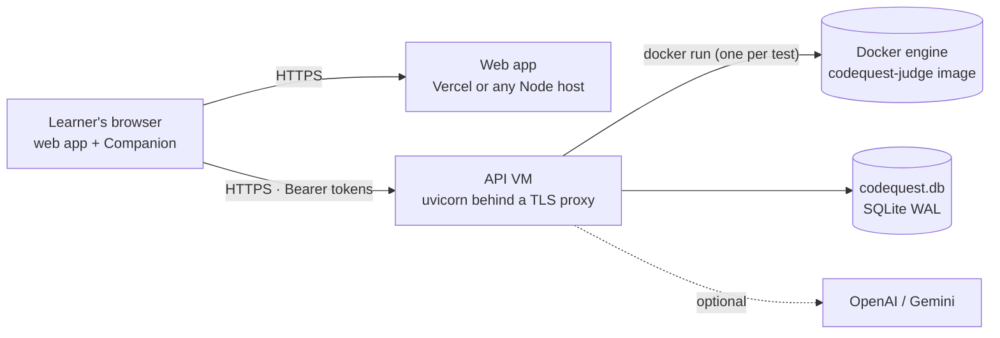

# Deployment and Configuration

CodeQuest has three deployable pieces: the **API** (FastAPI + SQLite + Docker sandbox), the **web app** (Next.js), and the **Companion extension** (loaded in the learner's browser). The API is the only piece that holds secrets.



---

## 1. Environment variables

Copy `.env.example` to `.env` at the repository root. Real environment variables take precedence over `.env`. **Never commit `.env`** (it is gitignored).

### API (`backend/`)

| Variable | Default | Description |
|---|---|---|
| `CQ_RUNNER` | `auto` | `docker`, `local` or `auto` (Docker if the judge image is present, otherwise the local fallback). **Use `docker` in any deployment** |
| `CQ_DOCKER_IMAGE` | `codequest-judge:latest` | Sandbox image |
| `CQ_DOCKER_RUNTIME` | empty | Set to `runsc` to run containers under gVisor |
| `CQ_DOCKER_STARTUP_S` | `6.0` | Host-side allowance for container start-up, on top of the per-test time limit. The in-container watchdog still enforces the learner's limit |
| `CQ_DB_PATH` | `codequest.db` | SQLite file |
| `CQ_ALLOWED_ORIGINS` | `http://localhost:3000` | Comma-separated exact web origins for CORS (e.g. your Vercel URL). Extension origins are always allowed by a strict regex |
| `OPENAI_API_KEY` | empty | Enables AI wording of hint 1 (`gpt-4.1-nano`) and the Companion tutor (`gpt-4.1-mini`) |
| `GEMINI_API_KEY` | empty | Second provider for hint wording (`gemini-2.0-flash-lite`) |
| `CQ_CHAT_MODEL` | `gpt-4.1-mini` | Model for the Companion tutor |
| `CQ_ROADMAP_MODEL` | `gpt-4.1-mini` | Model for roadmap coach notes (Structured Outputs; about $0.001 per plan, cached) |
| `CQ_AI_BUDGET_USD` | `2.0` | Hard spend cap shared by all AI features, persisted in the database |

With no AI keys every feature still works on deterministic templates.

### Web app (`frontend/`)

| Variable | Default | Description |
|---|---|---|
| `NEXT_PUBLIC_API_URL` | `http://localhost:8000` | Public URL of the API |

---

## 2. Local development

```bash
# 1. Sandbox image (optional but recommended), from the repository root
docker build -f runner/Dockerfile -t codequest-judge:latest .

# 2. API
cd backend
python -m pip install -e ".[dev]"
python -m uvicorn codequest.api:app --reload --port 8000

# 3. Web app (new terminal)
cd frontend
npm install          # postinstall self-hosts Monaco under public/monaco (no CDN at runtime)
npm run dev          # http://localhost:3000
```

Check `http://localhost:8000/api/health`: `"runner": "docker", "sandboxed": true` means the real sandbox is active.

If Docker Hub is unreachable (venue Wi-Fi), build from any local Python image: `docker build --build-arg BASE=<local-image> -f runner/Dockerfile -t codequest-judge:latest .`

---

## 3. Production

### API on a Linux VM

The Docker runner launches containers, so the API needs a host where it can reach a Docker engine: a small VM (any cloud provider) is the simplest. Platforms that don't expose Docker to the app cannot run the sandbox and would silently fall back to the unsandboxed runner, which is not acceptable for public use.

```bash
# on the VM (Ubuntu example)
sudo apt-get install -y docker.io python3.12 python3.12-venv
git clone https://github.com/HarshalAndhale9657/CodeQuest-AI-AI-Coding-Mentor-Debugging-Missions.git codequest
cd codequest
docker build -f runner/Dockerfile -t codequest-judge:latest .
python3.12 -m venv .venv && . .venv/bin/activate
pip install -e backend
cp .env.example .env   # set CQ_RUNNER=docker, CQ_ALLOWED_ORIGINS, keys, budget
cd backend && uvicorn codequest.api:app --host 127.0.0.1 --port 8000 --workers 1
```

- Run **one** uvicorn worker: rate limits and the judge pool live in process memory. Scale up the VM (or the judge pool) rather than the worker count.
- Put a TLS reverse proxy (Caddy, nginx) in front of `127.0.0.1:8000`. The extension refuses non-HTTPS servers other than localhost.
- Optional hardening: install gVisor and set `CQ_DOCKER_RUNTIME=runsc`.
- Back up `codequest.db` (and its `-wal` file) regularly.

### Web app on Vercel

1. Import the repository, set the **root directory** to `frontend/`.
2. Add `NEXT_PUBLIC_API_URL=https://<your-api-host>`.
3. Deploy, then add the Vercel URL to the API's `CQ_ALLOWED_ORIGINS`.

### Companion extension

Learners set the API's HTTPS origin in the panel's **Settings** and grant the permission prompt. To ship a store build with the production server built in, follow [EXTENSION.md §13](EXTENSION.md#13-packaging-and-publishing).

---

## 4. Pre-demo checklist

- [ ] `GET /api/health` shows `"sandboxed": true` and `"missions": 20`
- [ ] Arena: 8/8 attacks contained, runner shows `docker`
- [ ] **Try the demo as Priya** opens Class Average and the seeded profile (one prior off-by-one)
- [ ] Settings shows the AI provider and budget left, and the AI switch works both ways
- [ ] Companion: pairing code works, the panel loads a LeetCode problem, a hint and a code review return
- [ ] With the network off: hints, explanations and Mistake Memory still work (AI off path)
