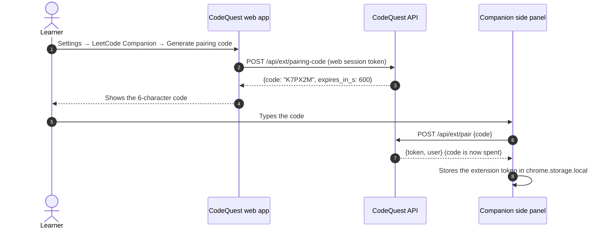
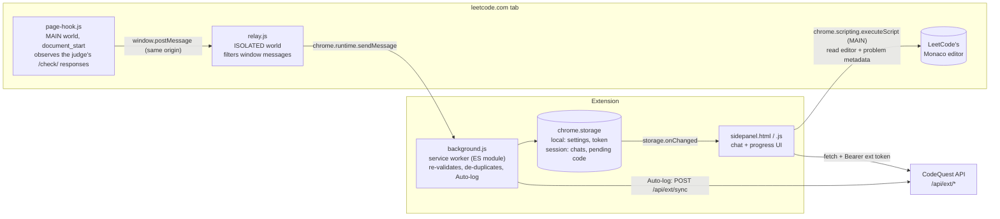
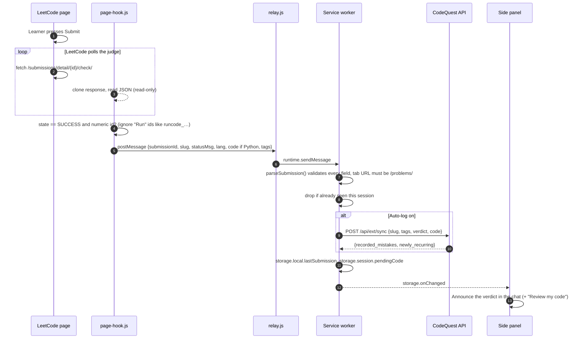
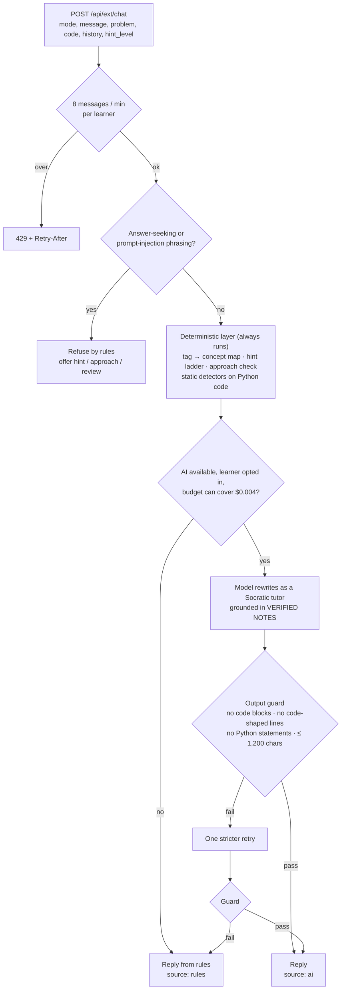

# CodeQuest Companion for LeetCode

> A Socratic tutor that lives in your browser's side panel, knows which LeetCode problem you have open, reads your code when you let it, and **never writes the solution for you**.

| | |
|---|---|
| **Type** | Chrome / Microsoft Edge extension, Manifest V3, side panel |
| **Version** | 0.3.0 (`extension/manifest.json`) |
| **Minimum browser** | Chrome 116+ (any Chromium browser with the `sidePanel` API, e.g. current Microsoft Edge) |
| **Works on** | `https://leetcode.com/problems/*` (switched off on `leetcode.com/contest/*`) |
| **Talks to** | Your CodeQuest server only (default: the deployed API, `https://codequest-api-31eg.onrender.com`) |
| **Code-review languages** | Python (static mistake detectors). The chat, hints, approach check, edge cases and complexity work for any language |

---

## Contents

1. [Why a companion](#1-why-a-companion)
2. [Features](#2-features)
3. [Download and install](#3-download-and-install)
4. [Connect it to your CodeQuest account](#4-connect-it-to-your-codequest-account)
5. [Using the Companion](#5-using-the-companion)
6. [How it works](#6-how-it-works)
7. [How the tutor stays honest](#7-how-the-tutor-stays-honest)
8. [Permissions, explained](#8-permissions-explained)
9. [Privacy and data flow](#9-privacy-and-data-flow)
10. [Configuration](#10-configuration)
11. [Troubleshooting](#11-troubleshooting)
12. [Testing the extension](#12-testing-the-extension)
13. [Packaging and publishing](#13-packaging-and-publishing)
14. [File map](#14-file-map)

---

## 1. Why a companion

Learners practise on LeetCode, but the help they reach for there is either nothing ("Wrong Answer") or everything (a pasted solution from a chatbot). CodeQuest's mentor already solves this inside our own practice environment. The Companion brings the same mentor to LeetCode:

- the **same rules**: hints get more specific step by step and never reveal the solution;
- the **same mistake detectors**: your Python code is checked for off-by-one loops, unhandled empty input, bad initial values and the rest of the CodeQuest catalogue;
- the **same Mistake Memory**: mistakes you make on LeetCode feed the profile you build on CodeQuest, so a pattern seen on both platforms becomes *recurring* and changes what CodeQuest recommends next.

---

## 2. Features

| Feature | What you see | Behind it |
|---|---|---|
| **Problem-aware tutor chat** | The panel shows the open problem's title, difficulty and topic tags. Ask anything in plain words | `POST /api/ext/chat` with the problem context and, if allowed, your code |
| **Hint (3 levels)** | `Hint 1/3 → 2/3 → 3/3`. Level 1 says what to *notice*; level 2 asks the sharper question (and, when AI-worded, may name the family of technique); level 3 states the key observation. Never code | Concept hint ladder keyed by the problem's LeetCode tags (`backend/codequest/extension.py`) |
| **Check my approach** | Describe your plan in a sentence; get *on track / part of this works / may not be the best fit / tell me more*, plus one guiding question | Technique phrases in your text are matched against the problem's topic tags; brute-force wording is detected |
| **Review my code** | The single most important issue, with its line number and a question that leads you to the failing input | CodeQuest's static AST detectors run on every function/method in your Python code |
| **Explain the problem** | What the problem is really asking, in plain words | Grounded in the statement; never hints at the algorithm |
| **Edge cases** | 3–4 inputs worth testing, without expected outputs | Deterministic list, optionally made problem-specific by the AI layer |
| **Complexity** | Help working out the time and space cost of *your* code or plan | Never names a faster algorithm; asks what work is repeated |
| **Auto-detected submissions** | When you press **Submit** on LeetCode, the verdict appears in the chat with a one-click *Review my code* | A read-only observer on LeetCode's judge endpoint (see [§6.3](#63-submission-detection)) |
| **Auto-log (opt-in)** | Your verdict and Python code are logged to CodeQuest, and newly recurring mistakes are announced | `POST /api/ext/sync`, same fusion rule as the web app |
| **Progress tab** | Last submission, Auto-log switch, manual logging, and your Mistake Memory (recurring, beaten, next mission) | `GET /api/ext/me` |
| **Source labels** | Every reply is labelled **AI tutor** or **CodeQuest** (rules), so you always know what produced it | `source: "ai" \| "rules"` on every reply |

---

## 3. Download and install

The Companion ships as an unpacked extension in the [`extension/`](../extension/) folder of this repository. It is not on the Chrome Web Store yet (see [§13](#13-packaging-and-publishing) for how to publish it).

### 3.1 Get the files

Pick one:

| Option | Steps |
|---|---|
| **`extension.zip`** (recommended for users) | Download [`extension.zip`](https://github.com/HarshalAndhale9657/CodeQuest-AI-AI-Coding-Mentor-Debugging-Missions/raw/main/extension.zip) from the repository root and unzip it to a folder you will keep (Chrome loads it from that folder every time it starts). It contains only the extension, about 250 KB |
| **Clone the repo** (recommended for developers) | `git clone https://github.com/HarshalAndhale9657/CodeQuest-AI-AI-Coding-Mentor-Debugging-Missions.git` |
| **Download the whole repo** (no Git needed) | On the GitHub page click **Code → Download ZIP**, then unzip it. The extension is the `extension/` folder inside |

### 3.2 Load it into the browser

**Google Chrome**

1. Open `chrome://extensions`.
2. Switch on **Developer mode** (top-right).
3. Click **Load unpacked** and choose the folder that contains `manifest.json` (the `extension/` folder).
4. Click the puzzle icon in the toolbar and **pin** *CodeQuest Companion for LeetCode*.

**Microsoft Edge**

1. Open `edge://extensions`.
2. Switch on **Developer mode** (left sidebar).
3. Click **Load unpacked** and choose the `extension/` folder.
4. Pin the extension from the extensions menu.

> [!IMPORTANT]
> Select the folder that has `manifest.json` **directly inside it**. Windows' *Extract All* on `extension.zip` often creates `extension\extension\manifest.json`; pick the inner `extension` folder. Choosing the outer one gives *Manifest file is missing or unreadable*.

Click the CodeQuest icon at any time to open the side panel. It stays open while you move between LeetCode problems and follows the active tab.

### 3.3 Start the CodeQuest server

The panel needs a CodeQuest API to talk to. For local use, start it from the repository root (full setup in the [main README](../README.md#quick-start)):

```bash
cd backend
python -m pip install -e ".[dev]"
python -m uvicorn codequest.api:app --port 8000
```

The panel talks to the deployed API (`https://codequest-api-31eg.onrender.com`) by default. To use your local server, open the panel's **Settings** and enter `http://localhost:8000`. The extension already has permission to reach it and `http://127.0.0.1:8000`. For any other server see [§10](#10-configuration).

### 3.4 Updating

After pulling new code (or unzipping a newer `extension.zip` over the same folder):

1. Open `chrome://extensions` and press the **reload** (↻) button on the CodeQuest card.
2. Reload any LeetCode tabs that were already open, so the new content scripts are injected.

---

## 4. Connect it to your CodeQuest account

The extension never sees your web login. It pairs with a **short-lived, single-use code** and receives its own separate token.



1. In the CodeQuest web app, open **Settings → LeetCode Companion** and click **Generate pairing code**.
2. Type the 6-character code into the side panel and press **Connect**.

Rules enforced by the server (`backend/codequest/store.py`):

- The code uses an unambiguous alphabet (no `0/O`, no `1/I`), works **once**, and expires after **10 minutes**.
- The extension token is **not** a web session token. It only works on `/api/ext/*` routes and expires after **7 days**; pair again when it does.
- If the server answers `401`, the panel drops the token and asks you to pair again.
- **Settings → Disconnect** in the panel forgets the token immediately.

---

## 5. Using the Companion

### 5.1 The chat view

Open any problem, for example `https://leetcode.com/problems/two-sum/`. The panel loads the title, difficulty and topic tags and greets you. Then:

- Use a **quick action chip** (Hint, Check my approach, Review my code, Explain the problem, Edge cases, Complexity), or type a question and press **Enter** (Shift+Enter for a new line).
- **Include my code** (on by default) lets the tutor read the solution editor for that message. Untick it to ask about the problem only.
- Each reply ends with **suggestion chips** for the most useful next step.
- **New conversation** clears the chat for the current problem. Conversations are kept per problem for the browser session.

Asking for the answer ("just give me the code", "solve it for me") or trying to override the tutor ("ignore your instructions") is refused **by rules, before any model is called**, and you are offered a hint instead.

### 5.2 The Progress view

| Control | What it does |
|---|---|
| **Auto-log my submissions** | Off by default. When on, each LeetCode **Submit** sends the verdict and (Python only) your code to CodeQuest, and the result is announced in the chat |
| **Last submission** | The most recent detected verdict, with **Log this submission** if Auto-log was off |
| **Log manually** | Pick a verdict and log the current problem yourself |
| **Your Mistake Memory** | Recurring mistakes, beaten mistakes, solved count, and the next CodeQuest missions picked for you |

A mistake is recorded only when a **detector finding meets a failed verdict**. An accepted submission never records a mistake. This is the same evidence rule the web judge uses, so the two platforms build one consistent profile.

### 5.3 Contests

The Companion is **disabled on `leetcode.com/contest/*`**. Content scripts are excluded there in the manifest, the service worker ignores any message from a non-`/problems/` tab, and the panel shows a contest notice instead of the chat. LeetCode forbids outside help during contests and we respect that.

---

## 6. How it works

### 6.1 Components



| Piece | World / context | Responsibility |
|---|---|---|
| `content/page-hook.js` | Page **MAIN** world, injected at `document_start` before LeetCode's scripts capture `fetch` | Wraps `window.fetch` as a pure observer. Reports only the final verdict of a real submission. Never changes a request or response; every failure is swallowed so the page is unaffected |
| `content/relay.js` | Extension **ISOLATED** world | Accepts only same-window, same-origin messages tagged `codequest-companion`, and forwards them to the service worker |
| `background.js` | Service worker | Opens the panel on toolbar click. Re-validates every submission (`lib/submission.js`), drops duplicates and anything not from a `/problems/` tab, and logs it only if Auto-log is on |
| `sidepanel.js` | Extension page | Tracks the active tab, reads the problem metadata and editor on demand, renders the chat and progress views, and calls the API |
| `lib/submission.js` | Shared, pure (no `chrome.*`) | Strict validator for page messages; maps LeetCode `status_msg` to CodeQuest verdicts |
| `lib/chat.js` | Shared, pure | Chat history trimming, labels, and safe rich-text rendering |

### 6.2 Reading the problem and your code

When the active tab is a problem page, the panel runs two small functions inside the page with `chrome.scripting.executeScript` (MAIN world):

- **`pageFetchProblem`** asks LeetCode's own GraphQL endpoint (same origin, your session) for the title, difficulty, topic tags and statement. The statement HTML is converted to text with `DOMParser`, which never executes scripts, and capped at 8,000 characters. Premium problems return no statement; the tutor then works from the title and tags.
- **`pageReadEditor`** reads the visible Monaco model. LeetCode keeps several models alive (the solution plus plaintext/JSON test inputs), so data models are skipped and the largest code model wins. It runs only when you send a message with **Include my code** ticked.

### 6.3 Submission detection



Verdict mapping (`lib/submission.js`):

| LeetCode `status_msg` | CodeQuest verdict |
|---|---|
| Accepted | `accepted` |
| Wrong Answer, Output Limit Exceeded | `wrong_answer` |
| Runtime Error, Memory Limit Exceeded | `runtime_error` |
| Time Limit Exceeded | `time_limit` |
| Compile Error, anything else | `other` |

Everything coming from the page is treated as **untrusted** (any script on the page can post messages): submission ids must be numeric, slugs and tags must match `^[a-z0-9-]+$`, status text is length-capped, at most 30 tags are kept, code is cut at 64 KiB and kept only for Python.

### 6.4 What the server does with a chat message



---

## 7. How the tutor stays honest

The Companion follows the same principle as the rest of CodeQuest: **decisions are deterministic, AI only words them.**

| Layer | What it guarantees | Where |
|---|---|---|
| **Rules first** | Requests for code/answers and prompt-injection phrasing are refused without calling a model | `ANSWER_SEEKING`, `INJECTION` in `backend/codequest/companion_chat.py` |
| **Deterministic grounding** | Every mode has a rules-based reply that is computed first. It feeds the model as *VERIFIED NOTES* and is the full fallback | `_deterministic()` |
| **Progressive disclosure** | Hint 1 may not name a data structure; hint 2 may name the family; only hint 3 states the key observation. The prompt forbids naming the optimal algorithm unless the learner proposed it | `MODE_TASK`, `SYSTEM_PROMPT` |
| **No invented bugs** | The model may call something a bug only if it can name a concrete small input on which it fails, and may not contradict the static notes. It is told LeetCode pre-imports `List`, `collections`, `ListNode`, etc., so it never reports those as missing | `SYSTEM_PROMPT` |
| **Output guard** | Rejects fenced code, long or statement-like inline code, code-shaped lines (`for x in y:`, `int x = 0;`, `{`), and anything that parses as a Python statement. One stricter retry, then the rules reply | `reply_is_safe()` |
| **Budget and kill switch** | The chat shares the AI layer's persisted USD budget, circuit breaker and per-learner on/off switch. Each call reserves its worst-case cost first, so concurrent calls can't overshoot | `AILayer.reserve()` / `charge()` |
| **Labelled sources** | Every reply says whether it came from the **AI tutor** or **CodeQuest** rules | `ChatReply.source` |

The model defaults to `gpt-4.1-mini` (set `CQ_CHAT_MODEL` to change it). With no `OPENAI_API_KEY`, or with AI switched off, every feature still works from rules.

---

## 8. Permissions, explained

| Permission | Why the Companion needs it |
|---|---|
| `sidePanel` | Shows the tutor in the browser's side panel |
| `storage` | `local`: server URL, extension token, Auto-log switch, last submission. `session`: chats per problem and the last submitted code (cleared when the browser closes) |
| `scripting` | Runs the two read-only page functions that fetch problem metadata and read the editor (§6.2) |
| Host `https://leetcode.com/*` | Content scripts for submission detection, and access to the problem tab |
| Host `https://codequest-api-31eg.onrender.com/*` | The default (deployed) CodeQuest API |
| Host `http://localhost:8000/*`, `http://127.0.0.1:8000/*` | A local CodeQuest server during development |
| Optional host `https://*/*` | Requested **at runtime, for one origin only**, when you set a deployed server URL in Settings. Plain `http` is refused for non-local servers |

Not requested: `tabs` history, cookies, `webRequest`, `<all_urls>` content scripts, or any remote code. The extension page CSP is `script-src 'self'; object-src 'none'; base-uri 'none'`.

---

## 9. Privacy and data flow

| Data | Leaves the browser? | Stored on the server? |
|---|---|---|
| Problem slug, title, difficulty, topic tags | With each chat message / log | Slug and tag-derived concepts only, for logged attempts |
| Problem statement | Only with a chat message | **Never stored or logged.** Used for that one reply |
| Your code | Only when you send a message with *Include my code*, press *Review my code* / *Log*, or on Submit with Auto-log on. Only Python code is logged | Chat: **never stored**. Logged attempts: analysed for mistakes; only the mistake keys are kept in your learner state |
| Chat history | Last 8 turns are sent with each message for context | **Never stored.** Chats live in `chrome.storage.session` |
| LeetCode's own hints and solutions | **Never read** | Never |
| Extension token | Sent only to your configured CodeQuest server | A random 256-bit token scoped to `/api/ext/*`, expires after 7 days |

Other safeguards:

- All server, model and page text is rendered with DOM nodes and `textContent`, never `innerHTML`, so nothing in a reply or a problem statement can inject markup.
- The page hook never modifies LeetCode's requests or responses and fails silently.
- When AI is on, the statement, your code and your messages are forwarded to the configured model provider for that reply. Turn AI off in CodeQuest **Settings** to keep everything on your CodeQuest server.

---

## 10. Configuration

### Point the panel at a different server

The default is the deployed API, `https://codequest-api-31eg.onrender.com`. It's the API origin, not the website (`https://codequest-ai-blond.vercel.app`), which answers `/api` calls with 404.

1. Open the panel, click the **gear** icon.
2. Enter the server origin, e.g. `https://api.codequest.example.com`, and press **Save**.
3. Chrome asks for permission to reach that origin. Accept it.
4. Pair again (tokens are per server).

### Server-side settings that affect the Companion

| Variable | Default | Effect |
|---|---|---|
| `CQ_ALLOWED_ORIGINS` | `http://localhost:3000` | Web origins for CORS. Extension origins (`chrome-extension://<32 a–p chars>`) are always allowed by a strict regex |
| `OPENAI_API_KEY` | empty | Enables the AI tutor. Without it the panel runs on rules only |
| `CQ_CHAT_MODEL` | `gpt-4.1-mini` | Model for the tutor chat |
| `CQ_AI_BUDGET_USD` | `2.0` | Hard spend cap shared by hint rewording and the tutor; persisted across restarts |

---

## 11. Troubleshooting

| Symptom | Cause | Fix |
|---|---|---|
| *Manifest file is missing or unreadable* on **Load unpacked** | The selected folder is the outer folder created by unzipping, not the one holding `manifest.json` | Select the inner `extension` folder that has `manifest.json` directly inside it |
| The extension shows an error or vanishes from `chrome://extensions` | Its unpacked folder was moved or deleted | Unzip `extension.zip` again into a folder you keep, then **Load unpacked** |
| "Can't reach the CodeQuest server at http://localhost:8000" | API not running, or a different port | Start `uvicorn codequest.api:app --port 8000`, or set the right URL in panel Settings |
| "Request failed (404)" when pairing | The server URL is the CodeQuest **website** (e.g. `https://codequest-ai-blond.vercel.app`), which has no `/api` routes | Set the server to the API origin in panel Settings (default: `https://codequest-api-31eg.onrender.com`) |
| "That pairing code is invalid or has expired" | Code older than 10 minutes, or already used | Generate a new code in web **Settings** |
| "The extension was disconnected. Pair it again." | Token expired (7 days) or the server database was reset | Pair again |
| Panel says *No problem open* | The active tab is not a `leetcode.com/problems/...` page | Open a problem, or click into its tab |
| "Couldn't read this problem. Reload the LeetCode tab." | The tab was open before the extension was installed or reloaded | Reload the LeetCode tab |
| Submissions are not detected | Content scripts were not injected into that tab, or you pressed **Run** (not **Submit**) | Reload the tab; only **Submit** results are tracked |
| *Review my code* says it supports Python only | The editor language is not Python | Switch LeetCode's editor to Python 3, or use the approach/hint modes, which work for any language |
| "That's a lot of questions in a minute" | 8 chat messages per minute per learner | Wait for the `Retry-After` time shown |
| Replies are always labelled **CodeQuest**, never **AI tutor** | No API key on the server, AI switched off for your account, or budget spent | Expected and safe. Check CodeQuest **Settings → AI wording** |
| A red error bar at the bottom of the panel | An unexpected script error | Reload the extension on `chrome://extensions`; if it persists, report the message shown |

---

## 12. Testing the extension

Dev-only harnesses live in [`extension-tests/`](../extension-tests/) and are not shipped with the extension.

```bash
# 1. A local server that imitates leetcode.com's judge endpoints, on http://localhost:5600
python extension-tests/server.py

# 2. The API must accept that origin
CQ_ALLOWED_ORIGINS=http://localhost:5600 python -m uvicorn codequest.api:app --port 8000   # from backend/
```

| Harness | URL | What it checks |
|---|---|---|
| **Pipeline** | `http://localhost:5600/problems/two-sum/?token=<extension token>&api=http://localhost:8000` | The full path hook → validator → service-worker logic → API, 17 checks |
| **Side panel UI** | `http://localhost:5600/tests/harness.html?scenario=python` (also `java`, `contest`) | The real panel with stubbed `chrome.*` APIs, for each scenario |
| **Side panel suite** | `http://localhost:5600/tests/harness.html?autotest=1&code=<pairing code>&api=http://localhost:8002` | 44 automated checks: pairing, hints, approach routing, review, jailbreak refusal, HTML injection, submission cards, problem switching, network failure and retry. Run it against an AI-off API (`OPENAI_API_KEY= ... --port 8002`) so it is deterministic and free. Generate the pairing code last: a new code cancels the previous one |

Server-side behaviour (pairing, token scope, sync fusion rule, chat refusals, output guard, budget sharing) is covered by `backend/tests/test_extension.py` and `backend/tests/test_companion_chat.py`.

---

## 13. Packaging and publishing

### Build a release ZIP

The ZIP must have `manifest.json` at its root.

```bash
# macOS / Linux
cd extension && zip -r ../codequest-companion-0.3.0.zip . -x '.*' && cd ..
```

```powershell
# Windows PowerShell
Compress-Archive -Path extension\* -DestinationPath codequest-companion-0.3.0.zip -Force
```

For the Chrome Web Store, upload this ZIP (manifest at the root).

### Refresh `extension.zip`

The `extension.zip` linked from the README is committed at the repository root and holds the `extension/` folder itself, so users unzip it and load that folder. **Rebuild it whenever `extension/` changes**, or downloads will be out of date:

```bash
# after committing the change under extension/
git archive --format=zip -o extension.zip HEAD extension
git add extension.zip && git commit -m "chore(extension): refresh extension.zip"
```

`git archive` packages only committed files with forward-slash paths, so the ZIP opens the same way on Windows, macOS and Linux.

### Chrome Web Store checklist

- [ ] Bump `version` in `manifest.json`.
- [ ] Set the default server to the production HTTPS origin and add it to `host_permissions` (or keep it optional and document the Settings step).
- [ ] Single-purpose description: "A tutor for LeetCode that gives hints and code feedback without revealing solutions."
- [ ] Justify each permission using [§8](#8-permissions-explained).
- [ ] Privacy disclosure using [§9](#9-privacy-and-data-flow): code and problem text are sent to the developer's server (and to the AI provider when AI is on), and are not sold or stored beyond the stated purposes.
- [ ] Screenshots of the chat, a hint, a code review and the Progress tab (1280×800).
- [ ] Upload the ZIP in the Chrome Web Store Developer Dashboard. Edge Add-ons accepts the same package.

---

## 14. File map

```
extension/
├── manifest.json          MV3 manifest: side panel, service worker, content scripts, CSP
├── background.js          Service worker: panel behaviour, submission validation, Auto-log
├── sidepanel.html         Panel markup: pairing, chat, progress, settings
├── sidepanel.js           Panel logic: active-tab tracking, page reads, API calls, rendering
├── sidepanel.css          Panel styles
├── tokens.css             Design tokens shared with the web app's LeetCode-style theme
├── content/
│   ├── page-hook.js       MAIN-world observer of LeetCode's judge responses
│   └── relay.js           ISOLATED-world relay to the service worker
├── lib/
│   ├── submission.js      Untrusted-message validator and verdict mapping (pure)
│   └── chat.js            Chat helpers and safe rich-text rendering (pure)
└── icons/                 16/32/48/128 px icons

backend/codequest/
├── extension.py           Tag→concept map, approach check, concept hint ladder, multi-function analysis
└── companion_chat.py      Tutor: rules, deterministic replies, model call, output guard
```
