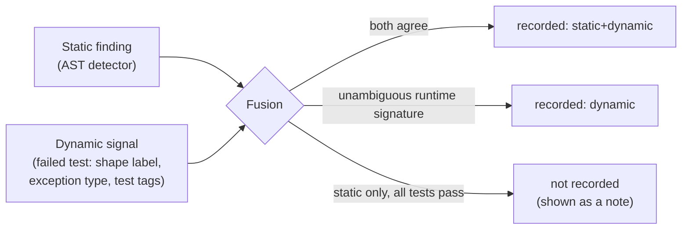

# The Mentor Engine

> How CodeQuest turns a failed submission into a lesson: plain-language explanations, a hint ladder that can't give the answer away, a memory of the mistakes you keep making, and a model of what you can do.

Everything on this page is deterministic and covered by unit tests in `backend/tests/` (mainly `test_judge.py`, `test_mentor.py`, `test_content.py`). The optional AI layer is described at the end; it never changes any of these decisions.

---

## 1. Plain-language explanations

Every explanation follows the same shape (`backend/codequest/analysis/explain.py`):

**what happened → where → evidence (visible tests only) → a question that points to the next step.** It never states the fix.

Example, for Priya's `class_average` on an empty list:

> On line 11 (`return total / count`) your code divided by zero. At that moment: `scores` = [], `total` = 0, `count` = 0, `i` = 0. Which input makes the divisor 0? What should your function return in that case?

The same submission's timeout card:

> The test ran out of time. `continue` jumps back before the loop variable is updated, so the loop can repeat forever. (line 6). Trace the loop by hand for one input: does it ever reach its stopping condition?

And a hidden test, which reveals only its category and a finding about the learner's own code:

> On a hidden boundary test your code returned a wrong answer. Hidden tests check that your solution works in general, not just on the examples, so their data stays private. A check of your code found something worth looking at on line 5: `< len(...) - 1` stops one element early.

(All three are verbatim engine output for Priya's demo submission, `PRIYA_CLASS_AVERAGE` in `backend/tests/conftest.py`.)

| Failure | What the explanation uses |
|---|---|
| Runtime error on a visible test | Exception type, the learner's own source line, up to 4 local variables captured at the crash (safely `repr`'d, never calling learner `__repr__`) |
| Wrong output on a visible test | The *shape* of the difference (table below) |
| Timeout | Static findings about the loop (e.g. a `continue` that skips the update) |
| Blocked operation | What the sandbox blocked, and the reminder that missions only need the function's inputs |
| Syntax error | Python's message translated, with line and column (missing colon, unclosed bracket, `=` vs `==`, indentation, unterminated string) |
| Missing function | The function name the mission expects |
| **Any hidden test** | Only the verdict, the coarse category and static findings about the learner's **own** code. Never input, output or message |

### Wrong-answer shapes

`backend/codequest/analysis/shape.py` classifies *how* a returned value differs from the expected one. On hidden tests these labels are used only internally, as evidence for mistake detection.

| Label | Example | Evidence for |
|---|---|---|
| `printed_not_returned` | returned `None`, but the answer was printed | `print_vs_return` |
| `returned_none` | no `return` on some path | `missing_return` |
| `off_by_one_number` | got 5, expected 6 | `off_by_one` |
| `skipped_end_element` | sum is short by exactly the first or last element | `off_by_one` |
| `missing_last` / `missing_first` / `extra_element` | `[1, 2]` vs `[1, 2, 3]` | `off_by_one` |
| `close_float` | 2.9999 vs 3.0 | `int_division` |
| `reversed`, `wrong_order`, `duplicates_differ` | right items, wrong arrangement | |
| `whitespace_or_case`, `text_vs_number`, `inverted_bool` | `"Hello "` vs `"hello"` | |
| `constant_output` | same result for 3+ different visible inputs | |

---

## 2. Static mistake detectors

`backend/codequest/analysis/detectors.py` walks the learner's AST. It **never executes learner code**. Each finding carries a line number and, where possible, the exact column span of the expression to blank out for hint 4.

| Key | What it catches | False-positive guard |
|---|---|---|
| `off_by_one` | `range(len(x) - 1)`, `x[len(x)]`, `i < len(x) - 1`, `i <= len(x)` | Pairwise loops that use `x[i + 1]` legitimately stop early and are skipped |
| `empty_input` | `x[0]` / `x[-1]` on a parameter, `max(x)` / `min(x)`, division by `len(x)` or by a counter initialised to 0 | Skipped when an earlier guard (`if not x`, `if len(x) == 0`, …) checks that name |
| `infinite_loop` | A `while` whose body never changes the condition's variables, or a `continue` that jumps back before the update | Loops with `break` or `return` are skipped |
| `base_case` | A recursive function with no non-recursive return before the recursive call | |
| `bad_initial_value` | `best = 0` followed by `if x > best: best = x` (fails on all-negative input) | |
| `mutate_while_iterating` | `remove` / `append` / `pop` / `insert` / … on the list being looped over | |
| `print_vs_return` | Prints but never returns a value | |
| `shadow_builtin` | Assigning to `sum`, `max`, `list`, `len`, … | |

Syntax errors are classified separately (`syntax:missing_colon`, `syntax:brackets`, `syntax:indentation`, `syntax:assign_vs_compare`, `syntax:string`).

---

## 3. Mistake fusion: when does a mistake count?

A static finding on its own is a *suspicion*. A mistake is **recorded** only when the evidence is strong (`judge.fuse_mistakes`):



| Mistake | Recorded when |
|---|---|
| `off_by_one` | detector fires **and** a failing test shows an off-by-one shape, an `IndexError`, or carries the `boundary` tag |
| `empty_input` | a test tagged `empty` / `zero` / `absent` crashes with `ZeroDivisionError`, `IndexError` or `ValueError`; or the detector fires and such a test fails |
| `infinite_loop` | detector fires **and** a test times out |
| `base_case` | any `RecursionError` |
| `print_vs_return` | the `printed_not_returned` shape appears |
| `missing_return` | `returned_none` on 2+ tests |
| `int_division` | `close_float` on 2+ tests |
| `bad_initial_value` | detector fires **and** a `negative`-tagged test fails |
| `mutate_while_iterating` | detector fires **and** any test fails |
| `shadow_builtin` | detector fires **and** a "not callable" `TypeError` occurs |

This is why the system is believable: it doesn't nag about a pattern that didn't actually hurt the learner. The LeetCode Companion uses the same rule: a finding counts only when LeetCode's verdict was a failure.

---

## 4. The hint ladder

`backend/codequest/hints.py`. Four levels, each strictly more specific than the last. Facts only accumulate.

Verbatim engine output for this submission to *Add Them Up*:

```python
def total(nums):
    result = 0
    for i in range(len(nums) - 1):
        result += nums[i]
    return result
```

| Level | Title | Contains | Example |
|---|---|---|---|
| **H1** | Where to look | The concept and a 2–3 line region of the learner's function | "This is about loop boundaries. Look closely at lines 2-4." |
| **H2** | What is going wrong | The mistake category plus a **generated counterexample** (or the mission's public edge-case list) | "Your loop seems to visit one position too few or too many. For input [1] the answer should be 1, but your code returned 0." |
| **H3** | Learn the idea | A mini-lesson on a **different** example, plus a self-explanation question | "`range(a, b)` produces a, a+1, ... up to b-1: it stops *before* b. Example on a different task: to print 1..n you write `range(1, n + 1)`. Now explain to yourself: Which index should the very last step of your loop use, and does your loop reach it?" |
| **H4** | Fill the blank | The learner's **own** faulty line with one expression blanked out | "Line 3 of your code: `for i in range(____):`. What belongs in the blank?" |

Missions whose reference solution has two statements or fewer stop at H3, because a blanked line would *be* the solution.

### Unlock gate

- H1 is available after the first judged submission that fails.
- Each further level needs **either** a changed resubmission **or** a 45-second cooldown. This rewards trying something over clicking "next hint".
- No hints once all tests pass.

### Hint credit

Hints are not free. When a mission is solved, the attempt score is the hidden-test pass fraction times a credit for the highest hint used, with a further ×0.85 after 3+ failed submissions:

| Highest hint | none | H1 | H2 | H3 | H4 |
|---|---|---|---|---|---|
| Credit | 1.00 | 0.90 | 0.75 | 0.60 | 0.40 |

### Counterexample finder (H2)

`backend/codequest/analysis/probe.py` enumerates small inputs **exhaustively, in increasing size** from each mission's `small_inputs` spec (e.g. lists of length 0–3 over `[-2, 0, 1, 3]`), so the first failure found is near-minimal. Expected values come from the reference solution, computed on the host. All candidates run in **one** sandboxed batch with a 3-second total budget (at most 300 candidates). **Every existing test input is excluded first**, so the hint can never reveal a hidden test. The result is cached per submission.

---

## 5. The leak guard

No hint may reveal the solution, including AI-worded hints. Before anything is shown, `leak_check` runs over the **union** of every hint already shown plus the new one (so the solution can't be assembled piece by piece):

1. **Normalise**: Unicode NFKC and zero-width characters removed (so `ra​nge` can't sneak past).
2. **No fenced code**: any ` ``` ` is rejected.
3. **Token check**: every identifier or number inside backticks must come from the learner's code, the starter code, the mission description, Python keywords, or vetted lesson text. Tokens that appear only in a reference solution are rejected.
4. **Statement check**: every statement of every reference solution (10+ characters, whitespace removed) that the learner hasn't already written is searched for in the union. A match is rejected.

On rejection the ladder falls back to the mistake's self-explanation question, then to a generic question, and records `source: "fallback"`. The test suite also runs every authored lesson through the guard against every mission (`test_authored_lessons_never_contain_reference_statements` in `test_mentor.py`).

---

## 6. Mistake Memory

`backend/codequest/learner.py`. Per learner, per mistake key *k*:

```
at the start of every attempt:      m_k ← 0.8 · m_k
first fused detection in an attempt: m_k ← m_k + 1      (counted once per attempt)

RECURRING  ⇔  m_k ≥ 1.5  and  k appeared in ≥ 2 of the last 5 attempts
BEATEN     ⇔  was recurring and m_k has decayed below 0.5
```

The decay means a mistake made long ago fades, while the same mistake twice in a short span crosses the threshold (1 × 0.8 + 1 = 1.8). The *2 of the last 5* rule means it must appear in two **different** attempts, so one bad mission can't trigger it.

### Adaptation: what changes when a mistake becomes recurring

The submission result carries an `adaptation` block, and the web app shows **Mistake Memory: a pattern spotted**:

1. **A debug mission is assigned**: the first unsolved debug mission whose `traps` include the recurring mistake (e.g. *The Broken Average* for `off_by_one`).
2. **Next missions are re-ranked** toward missions that trap that mistake (below).
3. **A pre-flight check** is added: e.g. *"Before you submit: check the first and the last position your loop visits."*

---

## 7. Skill tracking by concept

### Concept Elo

Each mission has a primary concept and optional secondary concepts. Difficulty comes from the tier (900, 1050, 1200, 1350, 1500; debug missions are 50 easier). Skill θ per concept is updated **once per solved attempt** (Pelánek's Elo variant for adaptive practice):

```
combined θ = 0.7 · θ_primary + 0.3 · mean(θ_secondary)
p          = 1 / (1 + 10^((d − combined θ) / 400))
θ_c       ← θ_c + K(n_c) · w_c · (score − p)        K(n) = 174 / (1 + 0.05 n)
```

`score` is the hint-credited attempt score above, so solving with H4 teaches the model less than solving unaided.

### Mastery bands

For each concept, against the median difficulty of its missions:

| Band | Rule |
|---|---|
| **Mastered** | θ − d_median ≥ 147 (≈ 70 % predicted success) **and** verified by 2+ solves with score ≥ 0.85 |
| **Almost** | predicted success on the median mission ≥ 50 % |
| **Learning** | attempted, below 50 % |
| **Ready** | not attempted yet |

### Next up: picking the next mission

For each unsolved mission:

```
fit      = max(0, 1 − |p − 0.75| / 0.35)          aim for ≈ 75 % success (desirable difficulty)
frontier = 1.0 ready · 0.6 learning/almost · 0 mastered
trap     = min(1, Σ m_k over recurring mistakes the mission traps / 3)
score    = 0.35 · fit + 0.20 · frontier + 0.35 · trap + 0.10 (if it is a debug mission that traps one)
```

Each recommendation carries a human reason: *"Targets your recurring mistake: off by one"*, or *"Right difficulty for you now (about 74% chance on first try)"*.

---

## 8. The demo learner, Priya

`service.PRIYA_HISTORY` seeds a believable history **through the real learner-model functions** (not hand-written numbers), so her bands, Elo and Mistake Memory are internally consistent:

| Order | Mission | Recorded mistakes | Score |
|---|---|---|---|
| 1 | Count the Evens | none | 1.00 |
| 2 | Find the Largest | `bad_initial_value` | 0.90 |
| 3 | Reverse Words | none | 1.00 |
| 4 | Add Them Up | `off_by_one` | 0.55 |

Exactly one off-by-one is on record, and it is the latest attempt. Her next off-by-one in a *different* mission (Class Average in the demo) makes it recurring live: 0.8 × 1 + 1 = 1.8 ≥ 1.5, seen in 2 of the last 5 attempts.

---

## 9. The optional AI layer

`backend/codequest/ai.py`. AI is allowed to do exactly one thing in the web app: **reword hint 1** so it sounds warmer. Hints 2–4 carry generated values or the learner's own code, which a model must never paraphrase.

| Safeguard | Detail |
|---|---|
| Minimal input | The model sees only the H1 note. Never the exercise, the reference, hidden tests or learner code. (Shown the exercise, models start solving it; this was observed live and is why the prompt is note-only) |
| Shape check | No code blocks, no code-like lines, no inline statements, backticks only for spans already in the note, ≤ 400 chars |
| Fact check | The set of numbers must be identical (so "lines 4-6" can't become "line 5") |
| Leak guard | The same `leak_check` as templates, over everything shown so far |
| Budget | Hard USD cap (`CQ_AI_BUDGET_USD`, default $2.00), persisted in SQLite across restarts; each call reserves its worst case first |
| Reliability | 5-second timeout, 3-strike circuit breaker per provider (60 s), LRU cache of 512 rewordings, OpenAI `gpt-4.1-nano` then Gemini Flash-Lite |
| Control | A per-learner switch in **Settings**, which also shows provider, budget left, hints reworded and **leaks blocked** |
| Transparency | AI-worded hints carry an *AI-worded* tag; `source` is `template`, `fallback` or `ai` |

The LeetCode Companion's tutor chat uses the same budget, switch and rejection counter, with its own output guard. See [EXTENSION.md §7](EXTENSION.md#7-how-the-tutor-stays-honest).

## 10. Learning signals

Pass/fail says whether code works, not whether the learner understands it. Four deterministic signals fill that gap. Evidence and citations: [research/learning-signals-evidence.md](research/learning-signals-evidence.md).

### Predict Before You Run (`predict.py`)
Before the first submission of an attempt the learner predicts what **their own** code returns for one input. The input comes from the counterexample finder's small-input domain, so it is never a visible test (its expected output is on screen) nor a hidden one (it would leak). Prompts are ranked to hit the mission's trap (an all-negative list for `bad_initial_value`, a list whose last element matters for `off_by_one`) and stay small enough to trace by hand; the choice is seeded by mission and attempt number, so a mission's first question is the same for everyone. One extra sandbox run gives the code's answer A; the reference gives E; the prediction is P:

| | P = A (read the code right) | P ≠ A (code surprised you) |
|---|---|---|
| **P = E** (knew the answer) | `aligned` | `slip`: the code doesn't do what you think |
| **P ≠ E** | `misconception`: the plan itself is wrong | `lucky` (A = E: passed, not as predicted) or `lost` |

The correct answer is shown only when the learner already knew it or their code produced it; otherwise it would be a counterexample handed out before the hint ladder allows one. Predictions stay out of the Elo estimate; the portfolio reports tracing accuracy per concept and flags concepts with 2+ lucky passes, or skill bands that outrun tracing.

### Pass review (`analysis/probe.py`, `analysis/rules.py`)
- **Fragile passes.** After every pass, on its own worker so verdicts never wait, the same bounded search that powers hint H2 runs over inputs beyond the tests (small-scope hypothesis). A counterexample marks the pass fragile: the solve stands, but half its Elo gain and its verified credit are held back, so mastery only counts code that survives inputs the tests missed. Example: counting each bracket type separately passes all 8 `valid_brackets` tests but accepts `"([)]"`.
- **Mission rules.** `forbidden_calls` (e.g. `largest`: no `max()`) are checked on the AST. Passing code that breaks a rule is not a solve.

### Debug Journey (`journey.py`)
Every judged submission of an attempt becomes a step: a line diff against the previous one and a label from the results (`progress`, `regression`, `sideways`) or from code identity via the AST (`resubmit` ignores comments and spacing, `revert` returns to an earlier version). The summary labels the style (`methodical`: small productive steps; `trial_and_error`: repeats and reverts without progress) and reports an Error Quotient adapted from Jadud (2006) to test results: per consecutive pair +2 both fail, +3 same failing tests, +3 same crash line, +1 same edit spot, divided by 9 and averaged. A reflection prompt asks how the learner debugged and compares the answer with the data.

### Growth analytics (`insights.py`)
The portfolio adds hint-free and first-try rates (rolling, with a trend), a struggle map of every mission by tier, mistake lanes over the full attempt log (recurring = an active "boss", beaten = defeated), the prediction matrix by concept, debugging styles and robust-solve counts. No radar chart: radial charts were the least effective design in comparative tests, so skills stay as bars.

