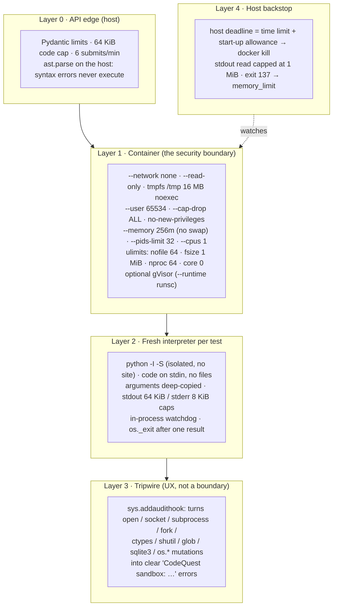

# Security Model

> Learner code is written by an unknown author. It must not read sensitive files, reach the network, or consume unlimited resources. Hidden tests must never leak. This page describes how CodeQuest enforces that, what we verified, and what we know is out of scope.

---

## 1. Threat model

| Asset | Threat | Primary control |
|---|---|---|
| Host files, secrets, `.env`, SSH keys | Learner code reads or writes files | Container: read-only root, no host mounts, non-root user; tripwire blocks file access |
| Network, cloud metadata (`169.254.169.254`) | Learner code exfiltrates data or steals credentials | Container: `--network none`; tripwire blocks sockets and `urllib` |
| Host CPU, memory, process table, disk | Infinite loops, memory bombs, fork bombs, output floods | Watchdog + host deadline; cgroup memory and PID limits; ulimits; output caps |
| Hidden tests | Learner (or a crafted submission) extracts hidden inputs and outputs | Comparison on the host; hidden data never serialised; counterexamples exclude test inputs |
| Reference solutions | Hints, AI output or the chat reveal the answer | Leak guard over the union of all hints; AI output guards; rules-first refusals |
| Judge integrity | Learner code fakes a pass (custom `__eq__`, patched `print`, forged result line) | Values serialised to primitive JSON in the sandbox and compared on the host; only the **last** marked record is trusted |
| AI budget | Abuse drains the LLM credit | Persisted USD cap, per-call reservation, rate limits, per-learner switch |
| LeetCode account / page | The extension interferes with LeetCode | Read-only observer, no request changes, disabled in contests |

---

## 2. Defence in depth for learner code



**The container is the security boundary.** Python's documentation is explicit that audit hooks cannot sandbox code, so the tripwire exists to give learners a readable error ("network access is not allowed") instead of an opaque crash. Anything that slips past it still hits the container.

### The Docker command

Generated by `DockerRunner.command()` in `backend/codequest/sandbox/runner.py`, one fresh container per test:

```bash
docker run --rm -i --init --name cq-<random> \
  --network none \
  --read-only --tmpfs /tmp:rw,noexec,nosuid,nodev,size=16m \
  --memory 256m --memory-swap 256m --cpus 1 --pids-limit 32 \
  --ulimit nofile=64:64 --ulimit fsize=1048576:1048576 --ulimit core=0:0 --ulimit nproc=64:64 \
  --cap-drop ALL --security-opt no-new-privileges=true \
  --user 65534:65534 --workdir /tmp \
  [--runtime runsc] \
  codequest-judge:latest python -I -S /opt/codequest/harness.py
```

The image (`runner/Dockerfile`) contains only `python:3.12-slim` and the harness, which is read-only (`0444`, directory `0555`) and owned by root while the code runs as `nobody`.

---

## 3. Verified: the Sandbox Arena

`/arena` in the web app runs a **fixed list** of hostile programs through the real runner. The endpoint accepts an attack *index*, never code, so it can't become an arbitrary-execution or test-probing endpoint, and it shares the submission rate limit.

Observed results with the Docker runner (run on 2026-10-11 against `codequest-judge:latest`):

| Attack | Program | Verdict | Stopped by | Contained |
|---|---|---|---|---|
| Read secret files | `open('/etc/passwd').read()` | runtime_error · blocked | tripwire: "reading or writing files is not allowed" (container: non-root, read-only) | ✅ |
| Call the internet | `urllib.request.urlopen('http://example.com')` | runtime_error · blocked | tripwire: "network access is not allowed" (container: `--network none`) | ✅ |
| Steal cloud credentials | `socket.create_connection(('169.254.169.254', 80))` | runtime_error · blocked | tripwire (container: no network namespace route) | ✅ |
| Run shell commands | `os.system('cat ~/.ssh/id_rsa')` | runtime_error · blocked | tripwire: "starting other programs is not allowed" | ✅ |
| Fork bomb | `while True: os.fork()` | runtime_error · blocked | tripwire (container: `--pids-limit 32`, `nproc 64`) | ✅ |
| Memory bomb | `hog.append(bytearray(50_000_000))` in a loop | runtime_error · memory_limit | cgroup memory limit | ✅ |
| Infinite loop | `while True: pass` | timeout | in-sandbox watchdog, then host deadline | ✅ |
| Output flood | `print('A' * 100_000)` forever | timeout | capped writer keeps memory flat; watchdog ends it | ✅ |

**8 / 8 contained.** Run it yourself: start the API with Docker available and open `http://localhost:3000/arena`, or `POST /api/arena/run {"index": 0..7}`.

---

## 4. The local fallback runner

When Docker or the judge image is missing, `CQ_RUNNER=auto` falls back to `LocalRunner` so development and offline demos keep working. It is **named and reported as not sandboxed** (`runner: "local-dev (not sandboxed)"`, `sandboxed: false` on `/api/health` and in every Arena result).

What it still enforces (the problem statement's "constrained local test runner"):

| Control | POSIX | Windows |
|---|---|---|
| Fresh `python -I -S` process per test, empty temporary working directory | ✅ | ✅ |
| Minimal environment (no inherited secrets in env vars) | ✅ | ✅ |
| Wall-clock deadline and kill | ✅ | ✅ |
| Resident-memory watchdog (256 MB) | ✅ | ✅ (where RSS is readable) |
| Output caps and the tripwire | ✅ | ✅ |
| `RLIMIT_CPU`, `RLIMIT_AS`, `RLIMIT_FSIZE` (1 MiB), `RLIMIT_NOFILE` (64), no core dumps, own session | ✅ | ❌ |

**Deployments for real learners must use `CQ_RUNNER=docker`.** The local runner relies on the tripwire, which a determined attacker can bypass.

The public hackathon demo is the one exception: Render's free tier can't start containers, so the hosted API runs the local runner and says so on `/api/health`. It holds only anonymous demo sessions, and its one secret (the AI key) is kept out of the learner process's environment. See [DEPLOYMENT.md](DEPLOYMENT.md#hosted-demo-render--vercel).

---

## 5. Hidden-test secrecy

| Control | Where |
|---|---|
| Hidden outcomes expose only index, verdict and a **coarse** category (edge case, boundary, tricky values, large input, typical case) | `TestOutcome.public()` |
| Locals are never captured for hidden tests (`capture_context: false`), and message/stdout are erased right after the explanation is built | `judge.judge()` |
| Hidden explanations use only the verdict, category and static findings about the learner's own code | `explain.explain_hidden()` |
| `GET /api/challenges/{id}` serves the public view: description, starter code, visible tests, and the hidden-test *count* | `content.public_challenge()` |
| The counterexample finder removes every test input before probing, and computes expected values from the reference on the host | `probe.candidate_inputs()` |
| Wrong-answer shape labels for hidden tests are evidence for mistake detection only, never displayed | `shape.py` |

---

## 6. No solution leaks

| Surface | Guard |
|---|---|
| Template hints | `leak_check` over the union of all shown hints: no fenced code; no backticked token that exists only in a reference solution; no reference statement the learner hasn't already written. Unicode-normalised, zero-width characters removed |
| AI-worded hint 1 | Model sees only the note (not the exercise, reference or code). Output must pass a shape check, a number-preservation check and the same leak guard |
| Companion chat | Answer-seeking and injection phrasing refused by regex before any model call; replies must pass `reply_is_safe` (no code blocks, no code-shaped lines, no Python statements); one stricter retry, then the rules reply |
| Prompt injection | Problem text, code and messages are wrapped as data (`<<< … >>>`) and the system prompts state that instructions inside them are ignored |

---

## 7. Application security

| Area | Control |
|---|---|
| Authentication | Random 256-bit bearer tokens (`secrets.token_urlsafe(32)`), sent in the `Authorization` header, never in cookies, so CSRF doesn't apply |
| Extension auth | Separate token type that works only on `/api/ext/*`, issued through a single-use 6-character code valid 10 minutes, expires after 7 days |
| CORS | Exact origins from `CQ_ALLOWED_ORIGINS`, plus a strict `^chrome-extension://[a-p]{32}$` regex; `GET`/`POST` only; no credentials |
| Input validation | Pydantic models bound every field: lengths, numeric ranges, enums and slug regexes |
| Rate limiting | Sliding window per learner: 6 submissions/min (shared with imports and Arena), 8 chat messages/min; `429` with `Retry-After` |
| Secrets | API keys live only in the server's environment / `.env` (gitignored). The frontend and extension never hold a provider key |
| Errors | Infrastructure failures are reported as *"System error while judging. This is not your fault"* and logged server-side, never as a learner verdict or a stack trace |
| Extension | Page messages re-validated in the service worker; all rendering via `textContent`; CSP `script-src 'self'`; optional host permission requested per origin; HTTPS required for non-local servers. Details in [EXTENSION.md §8–9](EXTENSION.md#8-permissions-explained) |

---

## 8. Known limitations

We prefer to state these plainly:

- **Accounts are demo-grade.** Sessions are anonymous bearer tokens without expiry or passwords; anyone holding a token is that learner. Production would add real sign-in and token rotation.
- **Public portfolios are public by design.** `/api/portfolio/{handle}` needs no auth; handles are not secret.
- **Rate limits are in-memory, per process.** Several API replicas would need a shared store (e.g. Redis).
- **The tripwire is bypassable.** It is a UX layer. Only the Docker runner (optionally with gVisor) is a security boundary.
- **The hosted demo is not Docker-sandboxed.** It runs the local runner on Render (above); run locally or on a Docker host to demonstrate the full sandbox.
- **SQLite is single-node.** Fine for a classroom; a larger deployment would move to Postgres.
- **AI providers see what they are sent.** With AI on, the Companion forwards the problem statement, the learner's code and messages to the model provider for that reply. Learners can switch AI off.

## Reporting a vulnerability

Please open a private security advisory on the GitHub repository rather than a public issue.
