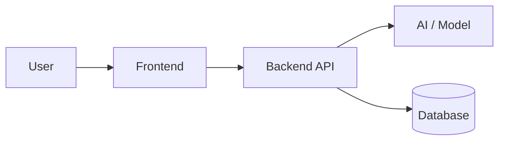

<!-- Copy to the repo root README.md at T+17 (feature freeze) and fill in. Delete the comments. -->

<div align="center">

# [Project Name]

**[One-line tagline: what it does, for whom]**

[🔗 Live Demo](https://) · [🎥 Demo Video](https://) · [📊 Pitch Deck](https://)

Built at **Vortexa [year]** · Track: [track name] · Problem Statement: [ID]

</div>

---

## 🚨 The Problem
<!-- 2–3 sentences. Who suffers, how much (one stat with a source), why current solutions fail. -->

## 💡 Our Solution
<!-- 2–3 sentences + the one-liner. -->


## ✨ Key Features
- **Feature 1:** benefit-oriented description
- **Feature 2:**
- **Feature 3:**

## 🏗️ Architecture
<!-- Diagram image (exported from Excalidraw/Figma/Mermaid) + 3–5 bullet walkthrough. -->



## 🧰 Tech Stack
| Layer | Tech |
|---|---|
| Frontend | |
| Backend | |
| AI / ML | |
| Data | |
| Deployment | |

## 🚀 Getting Started

### Prerequisites
- Node.js ≥ 22 / Python ≥ 3.12
- API keys: see `.env.example`

### Setup
```bash
git clone <repo-url>
cd <repo>
cp .env.example .env   # fill in keys
# frontend
# backend
```

### Demo credentials
<!-- If login is required: user / pass, or "click 'Try demo'". -->

## 📈 Impact
<!-- Quantified: time saved, users reached, cost reduced. Note assumptions. -->

## 🛣️ Roadmap
- [ ]
- [ ]

## 👥 Team
| Name | Role | GitHub |
|---|---|---|
| | Tech Lead · Full-stack | |
| | Frontend · UX | |
| | Backend · AI/ML | |

## 📄 License
MIT
